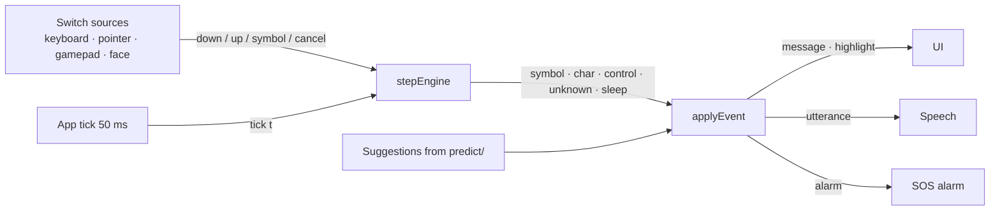

# Design: Morse engine

## Overview
Two pure reducers in `src/engine/`:

1. **`stepEngine(state, input, settings)`** turns switch inputs into engine events (symbols, characters, controls, sleep changes).
2. **`applyEvent(composer, event, context)`** turns engine events into the message being written, plus outputs (`utterance`, `alarm`).

Neither reducer reads a clock or starts a timer. The app shell sends `tick` inputs (about every 50 ms while symbols are pending) so that pauses can be detected. This makes every behaviour reproducible from an input log, which is what makes property-based testing practical.

## Architecture



## Components and interfaces

### Codec (`codec.ts`)
```ts
export type Symbol = '.' | '-';
export const CHAR_CODES: Readonly<Record<string, string>>;      // 'A' -> '.-'
export function decodeSequence(code: string): string | undefined;
export function encode(text: string): string[];                 // one code per character; ' ' -> '/'
export function decodeCodes(codes: string[]): string;           // inverse of encode
export function validateControls(controls: ControlMap): ControlCollision[];
```

### Engine (`engine.ts`)
```ts
export type EngineInput =
  | { kind: 'down'; t: number }
  | { kind: 'up'; t: number }
  | { kind: 'symbol'; symbol: Symbol; t: number }   // two-switch mode
  | { kind: 'cancel'; t: number }
  | { kind: 'tick'; t: number };

export type Control = 'SPACE' | 'ERASE' | 'NEXT' | 'ACCEPT' | 'SPEAK' | 'CLEAR' | 'SOS';

export type EngineEvent =
  | { type: 'symbol'; symbol: Symbol }
  | { type: 'char'; char: string }
  | { type: 'control'; control: Control }
  | { type: 'unknown'; code: string }
  | { type: 'sleep'; asleep: boolean };

export interface TimingSettings {
  mode: 'timed' | 'two-switch';
  minPressMs: number;          // default 40
  dashThresholdMs: number;     // default 350 (keyboard) / 700 (face)
  dashThresholdBounds: [number, number];   // [150, 2000]
  letterPauseMs: number;       // default 900 (keyboard) / 1500 (face)
  letterPauseBounds: [number, number];     // [400, 4000]
  autoWordSpace: boolean;      // default false
  wordPauseMs: number;         // default 2500
  sleepHoldMs: number;         // default 3000; must exceed dashThresholdBounds[1]
  adaptive: boolean;           // default true
  controls: ControlMap;        // defaults from morse-reference steering
}

export interface EngineState {
  lastT: number;               // last accepted timestamp
  downAt: number | null;       // start of the current press
  lastUpAt: number | null;
  pending: Symbol[];
  asleep: boolean;
  wordSpacePending: boolean;   // a char was committed; auto word space not yet sent
  estimates: { dotMs: number; dashMs: number; gapMs: number };   // running averages
  current: { dashThresholdMs: number; letterPauseMs: number };   // effective, after adaptation
}

export function initialEngineState(settings: TimingSettings): EngineState;
export function stepEngine(s: EngineState, input: EngineInput, settings: TimingSettings):
  { state: EngineState; events: EngineEvent[] };
```

**Step logic, in order:**
1. If `input.t < state.lastT`, return the state unchanged with no events (Req 2.5).
2. On `down` or `tick`: if symbols are pending, no press is in progress, and `t - lastUpAt >= current.letterPauseMs`, commit the pending symbols (Req 3.1). Committing looks up controls first, then characters, otherwise emits `unknown`. While asleep, only SOS passes through (Req 6.2, 6.3).
3. On `tick` with auto word space on: if `wordSpacePending` and `t - lastUpAt >= wordPauseMs`, emit SPACE once (Req 3.4).
4. On `down`: record `downAt`.
5. On `up`: `d = t - downAt`. If `d >= sleepHoldMs`, toggle sleep and clear pending symbols (Req 6.1). Else if `d < minPressMs`, ignore it (Req 2.1). Else classify it as a dot or dash and emit `symbol` (Req 2.2, 2.3). Then update the adaptive estimates.
6. On `cancel`: clear `downAt` without emitting anything (Req 2.4).
7. On `symbol` (two-switch mode): append it and set `lastUpAt = t` (Req 4.1).

**Adaptive timing (Req 5).** Exponential moving averages with α = 0.2:
- `dotMs`, `dashMs` are updated from classified press durations.
- `gapMs` is updated from gaps inside a letter (from `up` to the next `down` with no commit in between).
- If `dashMs / dotMs >= 1.8`, then `dashThreshold = clamp(sqrt(dotMs × dashMs), bounds)`.
- `letterPause = clamp(3 × gapMs, bounds)`.

### Composer (`composer.ts`)
```ts
export interface ComposerState {
  text: string;                 // committed text, including the current partial word
  highlight: number | null;     // index into the current suggestions
}
export interface ComposerContext {
  suggestions: string[];        // already filtered and ranked by predict/
  qcodes: Readonly<Record<string, string>>;   // 'QWA' -> 'I need water.'
}
export type ComposerOutput =
  | { type: 'utterance'; text: string }
  | { type: 'alarm' };
export function applyEvent(c: ComposerState, e: EngineEvent, ctx: ComposerContext):
  { state: ComposerState; outputs: ComposerOutput[] };
export function currentPartialWord(text: string): string;
```
- Q-code expansion is case-insensitive, matches the whole word only, and happens on SPACE, ACCEPT and SPEAK (Req 7.2, 7.7).
- A new `char` resets `highlight` to `null`. NEXT sets it to 0, then cycles (Req 7.5).
- SPEAK trims whitespace and emits nothing when the text is empty (Req 7.7).

## Data models
- `ControlMap = Record<Control, string>`, for example `{ SPACE: '..--', ERASE: '----', NEXT: '.-.-', ACCEPT: '---.', SPEAK: '.-.-.', CLEAR: '........', SOS: '...---...' }`.
- Presets: `KEYBOARD_TIMING` and `FACE_TIMING` (values above).

## Correctness properties
Each property is checked with `fast-check`, at least 200 runs each (1,000 for properties 1 and 4).

**Property 1: Round trip.** *For any* string over the supported characters and spaces, `decodeCodes(encode(s))` equals `s.toUpperCase()` with runs of spaces collapsed. **Validates: Requirements 1.1, 1.3, 1.4**

**Property 2: No collisions in the defaults.** The default control codes are distinct from each other and from every character code. *For any* control map with a collision, `validateControls` reports it. **Validates: Requirement 1.5**

**Property 3: Monotonic classification.** *For any* settings and durations `d1 <= d2` (both at least `minPressMs` and below `sleepHoldMs`), if `d2` classifies as a dot then `d1` does too. **Validates: Requirements 2.2, 2.3**

**Property 4: Tolerates jitter.** *For any* message (letters and spaces, with spaces sent as the SPACE control) and any unit `u` in 160–600 ms, with adaptive timing off, dash threshold = 2u and letter pause = 2.5u, the engine decodes the same message when dots (1u), dashes (3u) and gaps inside a letter (1u) are each jittered by up to ±30% and gaps between letters are drawn from 3u–5u. **Validates: Requirements 2.2, 2.3, 3.1, 3.2**

**Property 5: Short presses are inert.** *For any* state and any press shorter than `minPressMs`, the engine emits no events and changes only `lastT`, `downAt` and `lastUpAt`. **Validates: Requirement 2.1**

**Property 6: Never crashes, never emits junk.** *For any* random sequence of inputs (including out-of-order timestamps, double downs, cancels and ticks), `stepEngine` never throws, every `char` event holds a supported character, and inputs with past timestamps leave the state unchanged. **Validates: Requirements 1.2, 2.5**

**Property 7: Adaptive bounds hold.** *For any* sequence of presses and gaps, the effective dash threshold and letter pause always stay within their bounds. **Validates: Requirements 5.3, 5.4**

**Property 8: Adaptation converges.** *For any* dot length `a` in 100–600 ms, starting from a dash threshold anywhere in 1.3a–2.3a (as calibration would set it, with the estimates seeded at threshold ÷ √3 and threshold × √3), after 30 presses drawn from `a` ±15% and `3a` ±15% in any order, the dash threshold lies strictly between `1.15a` and `2.55a`. **Validates: Requirement 5.2**

**Property 9: Two-switch matches timed.** *For any* message, feeding its symbols as `symbol` inputs in two-switch mode, or as ideal presses in timed mode, with the same pauses, yields the same `char` and `control` events. **Validates: Requirement 4.3**

**Property 10: Asleep is silent except SOS.** *For any* input sequence fed while asleep that contains no sleep hold, the only `control` events are SOS and there are no `char` events. **Validates: Requirements 6.2, 6.3**

**Property 11: Erase is the inverse of typing.** *For any* composer text `t` and supported character `c`, applying `char c` then ERASE yields `t`. **Validates: Requirements 7.1, 7.3**

**Property 12: Nothing is put in the user's mouth.** *For any* sequence of engine events and suggestion lists, every utterance can be built only from decoded characters, accepted suggestions (those highlighted when ACCEPT was applied) and Q-code expansions. In particular, with no ACCEPT events and no Q-codes, the utterance equals the decoded characters and spaces. **Validates: Requirements 7.6, 7.8**

**Property 13: Q-codes expand whole words only.** *For any* word that is not exactly a phrasebook key (ignoring case), SPACE leaves it unchanged. *For any* key, SPACE replaces it with its phrase. **Validates: Requirement 7.2**

## Error handling
| Situation | Behaviour |
|---|---|
| Unknown sequence | Emit `unknown`; the UI shows "not a letter" on the tape and plays a soft low tone. |
| Settings with collisions or bad bounds | `validateSettings` returns errors; the settings UI blocks saving and names the collision. |
| Out-of-order timestamps | Ignored (Property 6). |
| A press that never ends (stuck switch) | The input layer sends `cancel` (see the switch-input spec). The engine just discards the press. |

## Testing strategy
- **Example tests** (`*.test.ts`): one per acceptance criterion where a property is overkill, such as the table lookups, SPEAK on empty text, and NEXT wrapping.
- **Property tests** (`*.pbt.test.ts`): properties 1–13. Shared generators live in `src/engine/test-gen.ts`: message strings, ITU timing streams with jitter, random input streams.
- **Replay fixtures:** record real input logs during development (`down`/`up` with timestamps) and keep a few as regression fixtures.
- The Kiro hook `test-engine-on-save` runs the engine tests on every save in `src/engine/`.
