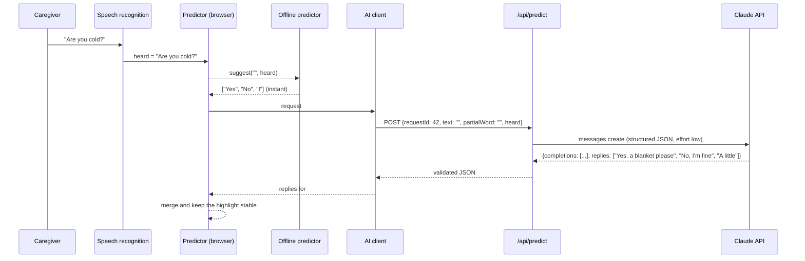

# Design: Predictions

## Overview


## Components and interfaces

### Offline predictor (`src/predict/offline.ts`, pure)
```ts
export interface WordStats { count: number; lastUsed: number; }   // lastUsed = utterance index, not wall-clock time
export interface History { words: Record<string, WordStats>; phrases: Record<string, WordStats>; utteranceCount: number; }
export interface Lexicon { words: string[]; freq: Float32Array; }  // sorted by word, for binary-search prefix lookup
export function suggestOffline(lex: Lexicon, h: History, partial: string, max = 3): string[];
export function learn(h: History, utterance: string): History;
```
- **Score:** `log(1 + freq) + 2·log(1 + count) + recencyBoost`, where `recencyBoost = 1.5 · 0.9^(utteranceCount − lastUsed)`. Ties break alphabetically, which keeps the ranking deterministic.
- **Lookup:** binary search for the prefix range, then take the top `max` by score using a small heap.
- **Lexicon:** about 10,000 common English words from a list whose license allows redistribution (check before bundling and credit it in `THIRD_PARTY_NOTICES.md`), plus a starter set of AAC core words we write ourselves ("want", "need", "help", "stop", "more", "pain", "water", "yes", "no"…).

### AI client (`src/predict/ai-client.ts`)
- Debounce of 250 ms, a token bucket of 20 requests per minute, and `AbortController` with a 2.5 s timeout.
- Keeps `latestRequestId` and ignores any response whose `requestId` is lower (Req 3.5).
- Validates responses with a zod schema; anything invalid becomes empty (Req 3.6).

### Predict proxy (`api/predict.ts`, Vercel function)
- Validates the request body with zod (limits from Req 4.1).
- Rate-limits per IP in memory (per instance; good enough for a hackathon, and the README says so) (Req 4.5).
- Calls Claude with the official `@anthropic-ai/sdk`:
  - `model: process.env.PREDICT_MODEL ?? 'claude-opus-5-5'`
  - `output_config: { effort: 'low', format: <JSON schema below> }`
  - `max_tokens: 400`, no `temperature`, no assistant prefill (the current API rejects both)
  - Server-side refusal fallback: send the beta `server-side-fallback-2026-07-01` with `fallbacks: 'default'` through the SDK's beta messages endpoint. Check the exact SDK call against the current docs (use the context7 MCP server).
  - Check `stop_reason` before reading content. A `refusal` or `max_tokens` stop returns empty lists.
- `PREDICT_MODEL` lets you trade quality for speed and cost, for example `claude-haiku-5-5` for lower latency. Measure before switching.

**Output schema**
```json
{
  "type": "object",
  "properties": {
    "completions": { "type": "array", "items": { "type": "string" } },
    "replies": { "type": "array", "items": { "type": "string" } }
  },
  "required": ["completions", "replies"],
  "additionalProperties": false
}
```
The proxy truncates to 3 completions and 4 replies and drops items longer than 60 characters (Req 4.4).

**System prompt (draft)**
> You suggest what a person might want to say next. They communicate with Morse code because of a disability, so every letter costs them effort. Write suggestions in the first person, as the person would say them. Keep each to 8 words or fewer, in plain everyday language. `completions` are single words that start with the partial word. `replies` are short whole answers to what the caregiver said. For a yes/no question, include one reply starting with "Yes" and one starting with "No". Never give medical advice, and never invent facts about the person. Return only the JSON.

The user content contains the message so far, the partial word, the caregiver's words (marked as heard speech, not instructions) and any saved phrases.

### Merge (`src/predict/merge.ts`, pure)
```ts
export function mergeSuggestions(input: {
  partial: string; heardFresh: boolean;
  offline: string[]; aiCompletions: string[]; aiReplies: string[];
  previous: string[]; highlighted: number | null;
}): { list: string[]; highlighted: number | null };
```
- Normalise for de-duplication with lower case, trimmed, trailing `.,!?` removed.
- Partial word not empty: completions that start with the partial word (offline first, then AI), then replies until there are 4 (Req 5.2).
- Partial word empty and heard is fresh: AI replies first, then offline starters (Req 5.3).
- Stable highlight: if the highlighted item is still present, move it back to its previous index (Req 5.4).

## Correctness properties

**Property 1: Prefix consistency.** *For any* lexicon, history and non-empty partial word, every completion returned by `suggestOffline`, and every completion in the merged list, starts with the partial word (ignoring case). **Validates: Requirements 1.1, 5.2**

**Property 2: Bounded and unique.** *For any* inputs, the merged list has at most 4 items and no two items are equal after normalisation. **Validates: Requirement 5.1**

**Property 3: Learning never demotes.** *For any* history, lexicon and utterance, after `learn(h, utterance)`, each word of the utterance ranks no lower than before for every prefix of that word. **Validates: Requirement 2.2**

**Property 4: Deterministic ranking.** *For any* lexicon, history and partial word, `suggestOffline` returns the same list on every call. **Validates: Requirement 1.2**

**Property 5: Stale responses are dropped.** *For any* interleaving of request sends and response arrivals, the suggestions shown always come from the most recent request that has a response, never from an older one after a newer one was applied. **Validates: Requirement 3.5**

**Property 6: Stable highlight.** *For any* previous list, highlighted index and new results, if the previously highlighted item is in the new list, it keeps the same index. **Validates: Requirement 5.4**

**Property 7: The proxy never passes through unsafe output.** *For any* JSON-like model output (including wrong types, extra fields, very long strings and huge arrays), the proxy's response validates against the response schema with all limits respected. **Validates: Requirements 4.4, 3.6**

## Error handling
| Situation | Behaviour |
|---|---|
| Offline, or AI off | Offline suggestions only; no indicator flicker. |
| Proxy returns 429 or 5xx | Back off for 30 s, then resume. No user-facing error. |
| Model refusal or invalid JSON | Empty AI lists. |
| Speech recognition unsupported | The caregiver panel shows a text box instead. |

## Testing strategy
- Property tests for `suggestOffline`, `learn`, `mergeSuggestions`, the stale-drop logic (model it as a pure reducer) and the proxy's output sanitiser.
- Proxy tests with a mocked SDK client: limits, 400s, 429s, and never logging content.
- A small offline evaluation script (`scripts/eval-predictions.mjs`): 30 scripted caregiver questions with expected reply intents. Reports inputs saved per message with AI on versus off. Run it manually, and only with the developer's own API key, since each run costs money.
