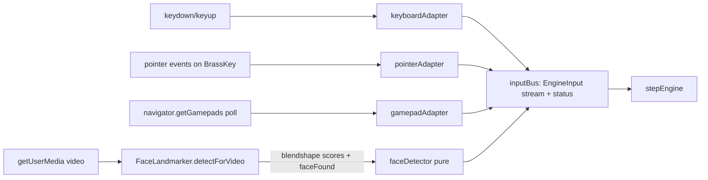

# Design: Switch input

## Overview
Each source has a thin **browser adapter** (listeners, camera, gamepad polling) and, where there is logic, a **pure detector** that turns timestamped samples into engine inputs. Pure detectors take time as an argument, like the engine, so they can be property-tested with synthetic streams.



## Components and interfaces

### Shared types (`src/input/types.ts`)
```ts
export type SourceKind = 'keyboard' | 'pointer' | 'gamepad' | 'face';
export type Gesture = 'blink' | 'brow' | 'mouth';
export type InputStatus = 'ready' | 'no-face' | 'slow' | 'camera-denied' | 'loading-model';
export interface SwitchBinding { source: SourceKind; key?: string; button?: number; gesture?: Gesture; }
export interface SwitchProfile {
  mode: 'timed' | 'two-switch';
  primary: SwitchBinding;
  secondary?: SwitchBinding;      // two-switch mode only
  face?: Partial<Record<Gesture, GestureThresholds>>;
}
export interface GestureThresholds { on: number; off: number; minHoldMs: number; }
```

### Pure face detector (`src/input/face-detector.ts`)
```ts
export interface FaceSample { t: number; faceFound: boolean; scores: Record<Gesture, number>; }
export interface FaceDetectorState {
  phase: 'idle' | 'arming' | 'active';  // arming = above on, waiting for the minimum hold
  armedAt: number | null;
  lastFaceAt: number;
}
export function stepFace(s: FaceDetectorState, sample: FaceSample, g: Gesture, th: GestureThresholds):
  { state: FaceDetectorState; inputs: EngineInput[]; status?: InputStatus };
```
- **idle → arming:** the score rises above `on`; record `armedAt = t`.
- **arming → active:** the score stays above `off` and `t - armedAt >= minHoldMs`; emit `down` at `armedAt` (Req 2.3).
- **arming → idle:** the score drops below `off` first; emit nothing (Req 2.5).
- **active → idle:** the score drops below `off`; emit `up` at `t` (Req 2.4).
- **No face for more than 500 ms while arming or active:** go to idle; if active, emit `cancel` (Req 3.1).
- The score for `blink` is `min(eyeBlinkLeft, eyeBlinkRight)`, so a wink or a squint with one eye doesn't count. `brow` uses `browInnerUp`. `mouth` uses `jawOpen`.

Because `down` is stamped back at `armedAt`, the engine measures the true press duration even though it hears about the press `minHoldMs` later.

### Face adapter (`src/input/face-adapter.ts`)
- `getUserMedia({ video: { width: 640, height: 480, facingMode: 'user' } })`.
- `FaceLandmarker.createFromOptions` with `runningMode: 'VIDEO'`, `outputFaceBlendshapes: true` and `numFaces: 1`. WASM and model are served from `/models/`.
- A `requestAnimationFrame` loop calls `detectForVideo(video, performance.now())`, builds a `FaceSample` and runs `stepFace`.
- Tracks the frame rate over a 3 s window and reports `slow` below 10 fps (Req 5.3).
- Never draws frames to a canvas that persists, never calls `toDataURL`, never uploads (Req 2.2).

### Keyboard, pointer and gamepad adapters
- Keyboard: listen on `window`; ignore `event.repeat` (Req 1.2). Use `event.timeStamp` mapped to the `performance.now()` timebase.
- Pointer: `pointerdown` / `pointerup` / `pointercancel` on `BrassKey`, with `setPointerCapture`. `pointercancel` emits `cancel`.
- Gamepad: poll `navigator.getGamepads()` every animation frame and diff the button states (Req 1.4).
- Every adapter emits `cancel` on `visibilitychange` to hidden if it is down (Req 3.2).

### Calibration math (`src/input/calibration.ts`, pure)
```ts
export function thresholdsFromSamples(rest: number[], peaks: number[]):
  { ok: true; on: number; off: number } | { ok: false; reason: 'not-distinct' };
export function timingFromPresses(shortMs: number[], longMs: number[], bounds: Bounds):
  { dashThresholdMs: number; letterPauseMs: number };
```
- `rest95 = p95(rest)`, `peak = median(peaks)`. If `peak - rest95 < 0.15`, the gesture isn't distinct enough. Otherwise `on = rest95 + 0.6 × (peak - rest95)` and `off = rest95 + 0.4 × (peak - rest95)` (Req 4.1, 4.2).
- `dashThreshold = clamp(√(median(short) × median(long)))` and `letterPause = clamp(2.5 × median(short))` (Req 4.3).

### Calibration wizard UI (`src/ui/onboarding/CalibrationWizard.tsx`)
Steps: choose gesture (each with a live meter) → rest 5 s → 5 gestures → 5 short and 5 long presses → practice. Each step continues on one press of the switch being calibrated (Req 4.4).

## Correctness properties

**Property 1: Strict alternation.** *For any* stream of face samples, the emitted inputs for a switch never contain two `down`s without an `up` or `cancel` between them, and never an `up` or `cancel` without a preceding `down`. **Validates: Requirements 3.4, 2.3, 2.4**

**Property 2: Brief activations are filtered.** *For any* stream in which every excursion above `on` lasts less than `minHoldMs` before dropping below `off`, no inputs are emitted. **Validates: Requirements 2.5, 2.6**

**Property 3: Faithful timestamps.** *For any* stream, emitted timestamps never decrease, and each `down` timestamp equals the first sample of its excursion above `on`. **Validates: Requirement 2.3**

**Property 4: Nothing stuck when the face disappears.** *For any* stream that ends with more than 500 ms of `faceFound: false`, the detector ends idle, and if a press was active, a `cancel` was emitted. **Validates: Requirement 3.1**

**Property 5: Hysteresis prevents chatter.** *For any* stream whose scores stay strictly between `off` and `on` after activation, no extra `up`/`down` pairs are emitted. **Validates: Requirements 2.3, 2.4**

**Property 6: Sensible calibration.** *For any* rest and peak samples with `median(peaks) - p95(rest) >= 0.15`, `p95(rest) < off < on < median(peaks)`. Otherwise the result is `not-distinct`. **Validates: Requirements 4.1, 4.2**

**Property 7: Timing calibration stays in bounds and in order.** *For any* positive short and long press samples, the results are within the engine's bounds. When `median(long) > median(short)`, the dash threshold lies between the two medians (before clamping). **Validates: Requirement 4.3**

## Error handling
| Situation | Behaviour |
|---|---|
| Camera permission denied | Status `camera-denied`; UI explains how to allow the camera and offers keyboard or touch instead. |
| Model fails to load (offline, first run) | Status `loading-model` with retry. The PWA precaches the model after the first successful load. |
| No face | Status `no-face`; UI shows "I can't see you" plus a lighting tip; `cancel` if a press was active. |
| Low frame rate | Status `slow`; UI suggests closing tabs. Detection keeps working at the lower rate. |
| Gamepad disconnected | Fall back to keyboard; toast "Switch disconnected". |

## Testing strategy
- Property tests for `stepFace` and the calibration functions with synthetic score streams (`*.pbt.test.ts`).
- Example tests for the keyboard adapter (repeat ignored, cancel on hidden) using a mocked `window`.
- Manual test script in `docs/` for real camera checks in different lighting, with glasses, and with users who can't fully close their eyes.
- Playwright end-to-end tests use the keyboard source only; the camera is never required in CI.
